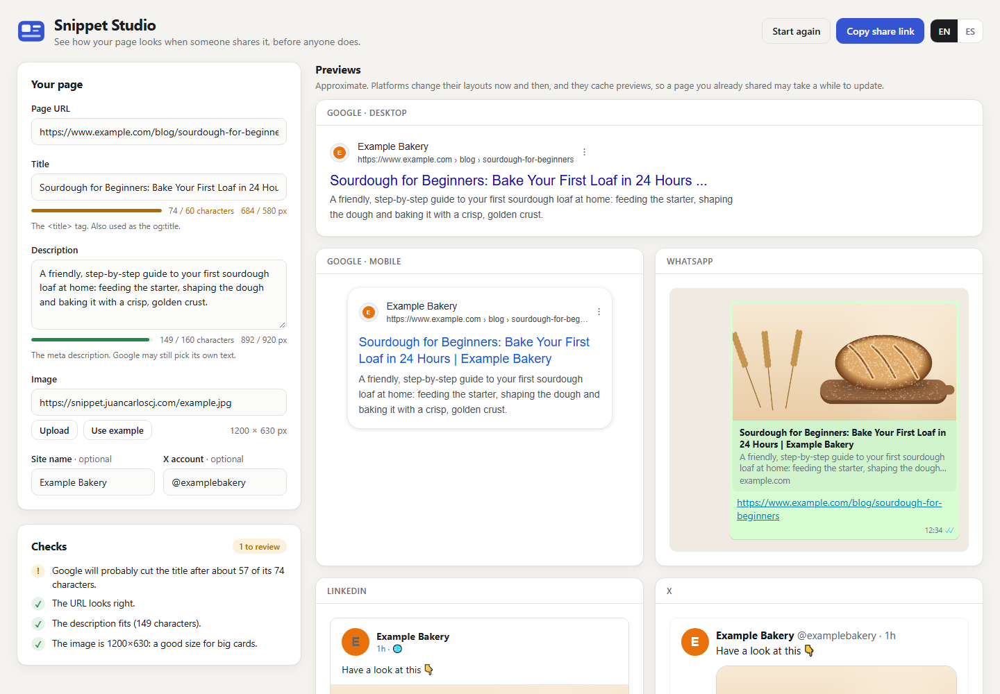
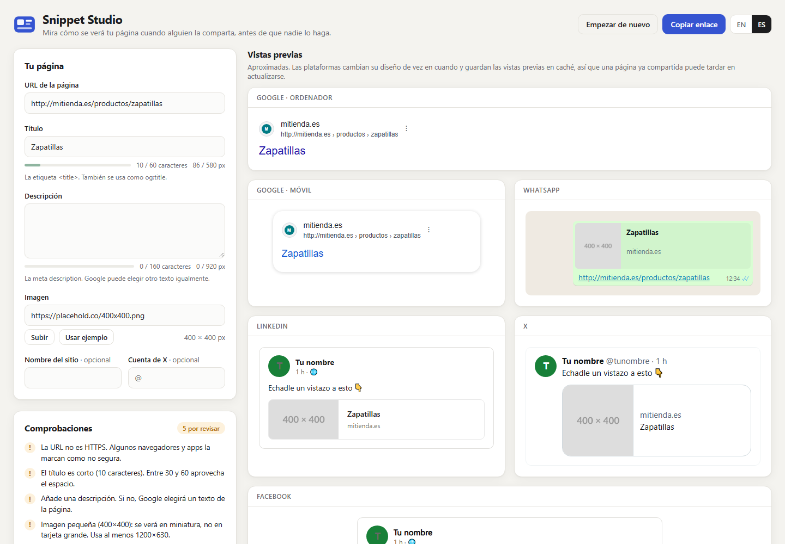
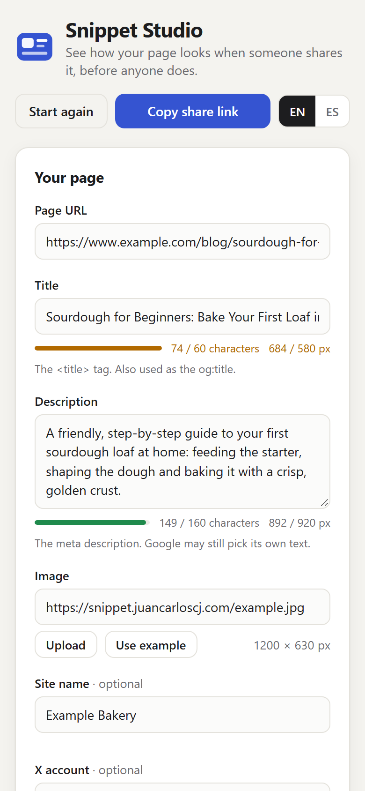
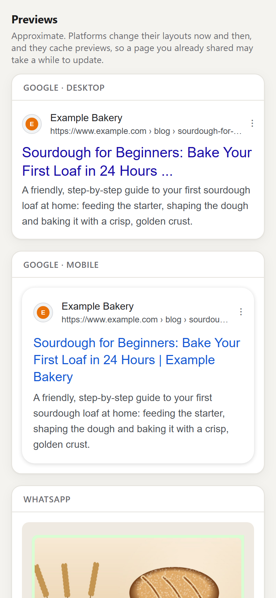

# Snippet Studio

Every time I finish a website, someone shares the link on WhatsApp or LinkedIn, and that's when you find out the title is cut in half, the description is missing or the image is cropped in a strange way. By then the preview is cached and it's too late. So I built a small tool to check all of that before the link goes out.

You type in your page's URL, title, description and image, and you see straight away how the link will look on Google (desktop and mobile), WhatsApp, LinkedIn, X and Facebook. It also tells you what's wrong and gives you the meta tags ready to paste into your page.

**Try it here:** [snippet.juancarloscj.com](https://snippet.juancarloscj.com)



## What it does

- **Live previews** for Google desktop, Google mobile, WhatsApp, LinkedIn, X and Facebook, updated as you type.
- **Character and pixel counters.** Google cuts titles by width in pixels, not by number of characters, so a title full of "W"s gets cut much earlier than one full of "i"s. I measure the text with a hidden canvas using the same font Google uses, and cut it the same way, at the last whole word.
- **Checks** that point out what to fix: a missing or too-long title, a short description, a URL without https, an image that's too small, the wrong shape or too heavy.
- **Images by URL or upload.** You can paste an image URL or drop a file from your computer. Small or square images switch the previews to the small-thumbnail layout, like the real platforms do.
- **Copy-ready meta tags:** title, description, canonical, Open Graph and X (Twitter) cards. Empty fields are left out, and everything is escaped properly.
- **Share links.** Everything you type is saved in the address (`#s=...`), so you can send someone a link that opens with the same content.
- **English and Spanish.** It picks the language from your browser, and remembers it if you switch.

Nothing is sent anywhere: it all runs in your browser.

| Warnings (in Spanish) | Phone | Previews on a phone |
|---|---|---|
|  |  |  |

The previews are approximate. Each platform changes its layout every now and then, and none of them publish their exact limits, so I used the measurements most people work with (about 580 px for a Google title, 1200×630 for share images, and so on). They're all in one place, [`src/lib/limits.ts`](src/lib/limits.ts), so they're easy to update.

## How I built it

It's React 19 with TypeScript, built with Vite. There's no backend and no UI library; the styles are plain CSS.

I kept the logic apart from the interface. Everything that decides something (measuring and cutting text, reading URLs, running the checks, writing the meta tags, encoding share links) lives in `src/lib/` as plain functions with no React in them, and those are the parts with tests. The components only show the results.

A few details I liked working on:

- **Cutting text like Google does.** A binary search finds the longest piece of text that still fits with the " ..." on the end, then it goes back to the last whole word, unless that would throw away too much. It also never splits an emoji in half.
- **Reading image sizes.** To get an image's real size I just load it into an `Image` object, which works for any URL without CORS problems. Uploaded files use a temporary object URL that gets freed when you change the image.
- **Share links that survive accents and emoji.** The state is turned into JSON, then UTF-8, then URL-safe base64. Anything broken or unexpected in a link is ignored rather than crashing the page.
- **The example image** of the loaf is drawn from code, by [`tools/make-example-image.py`](tools/make-example-image.py).

## Running it locally

You'll need [Node.js](https://nodejs.org) 18 or newer.

```bash
git clone https://github.com/JuanCarlosCJ/snippet-studio.git
cd snippet-studio
npm install
npm run dev
```

Then open the address Vite shows you (usually http://localhost:5173).

| Command | What it does |
|---|---|
| `npm run dev` | Starts the development server |
| `npm run build` | Type-checks and builds the site into `dist/` |
| `npm run preview` | Serves the built site locally |
| `npm test` | Runs the tests (Vitest) |
| `npm run image` | Redraws the example image (needs Python 3 with Pillow) |

## Project structure

```
src/
  lib/            the logic, no React
    limits.ts     platform limits (title width, image sizes...)
    measure.ts    text width with a hidden canvas
    truncate.ts   cutting text to a pixel width
    url.ts        reading URLs and Google's breadcrumb line
    checks.ts     the list of warnings
    metaTags.ts   the <head> tags
    share.ts      share links
    hooks.ts      image loading, copy button, debouncing
    lib.test.ts   tests
  i18n/           English and Spanish texts
  components/     editor, checks, code box and previews
    previews/     Google, WhatsApp, LinkedIn, X and Facebook
public/           example image, favicon, share image
tools/            example image generator
docs/             screenshots
```

## Deploying it

It's a static site, so anything that can serve files works. I run `npm run build` and upload the contents of `dist/` to a subdomain on my server, which handles HTTPS.

## License

[MIT](LICENSE) © Juan Carlos
